# Spike: the Spectrum marker on UI SDK

Issue #45. A try at rebuilding the **Spectrum** position control in `src/components/SpectrumStage.vue` on UI SDK (`@ui-sdk/core` + `@ui-sdk/vue`, `0.1.0-beta.17`), before the redesign commits to it ([ADR 0003](../../adr/0003-ui-sdk-for-interactive-components.md)).

## Verdict

**UI SDK carries the Spectrum, with caveats.** Its stock `Slider` fits: there was no need to drop down to `definePrimitive`. Mouse, touch, keyboard, lock-in, the reveal, live moves and the notch pulse all work, and the intents go out at the same rate as before. Screen-reader output is better than today's. The caveats are small, and none of them blocks the redesign:

- Page Up and Page Down jump between notches only because the slider is controlled: we swap UI SDK's proposed value for the next notch in `@value-change`. There's no option for "snap points" or custom key steps.
- Holding an arrow key now sends one `settled` move when the key comes up, not one per key repeat (see [Intents](#intents-sent)).
- The first UI SDK entry on a page pays for the shared runtime: **+24.1 kB gzip** of JS (+38%), of which the `Field` used for the label is about 4.5 kB.
- web.css's `Field` gap and `Slider` thumb styles have to be overridden (see [Rough edges](#rough-edges)).

The hard part of the issue wasn't the slider. It was showing 15 long names on one track without overlap, and UI SDK has nothing for that. That's our own code (`stackLabels`), and it would be needed with a native `<input type="range">` too.

Per ADR 0003, `main` never ships a half-migrated UI, so this PR can wait for the redesign, or be closed and its approach reused there.

## What was built

- **`SpectrumStage.vue`**: your position is a UI SDK `Slider` (`SliderControl` → `SliderTrack` → `SliderThumb`) in a `Field` with a `FieldLabel` ("Your position"). The five notches are tick marks inside the track. The slider is controlled (`:value` + `@value-change`). `@value-change` feeds the existing 120 ms move throttle, and `@value-commit` sends the `settled` move. `:format="describePosition"` sets what screen readers hear. People without a slider (the Host when not Playing, Spectators) get a plain line with the same ticks.
- **The same track for everyone's markers.** Names sit in rows above the line, each with a stem and a dot down to its exact spot. `stackLabels` puts each label on the lowest row where it doesn't overlap another. Labels are anchored so the ones at either end stay inside the card. Your own label follows your thumb while you drag, rather than waiting for the Room's echo. Long names are clipped with an ellipsis (the full name is in `title`).
- **`src/lib/spectrumTrack.ts`** (new, tested): `nextNotch` (Page Up/Down), `describePosition` (the slider's `aria-valuetext`) and `stackLabels` (the row layout).
- **`src/style.css`**: the Spectrum section is rewritten. The notch pulse now animates `scale` rather than `transform`, so it doesn't fight the label's anchoring `translate`. Reduced motion also turns off the labels' slide.
- **A bug fixed on the way**: the watch that resets the slider on a new Prompt used a getter returning a fresh array, so it fired on **every** view from the server. Each time anyone moved, your slider snapped back to the Room's last copy of your position. In the before run this sometimes undid a key press (PageUp, then PageUp again, read 11 then 10). It is now a two-source watch.

## Screenshots

Captured by a Playwright run under `vp dev`: 14 bot Participants with 19–20 character names, plus the browser's own Participant, "Theodora Rosenquist". Device scale 2. Most bots are bunched around Neutral to stress the layout.

|                                        | Before                               | After                               |
| -------------------------------------- | ------------------------------------ | ----------------------------------- |
| Revealed, phone (390×844)              | 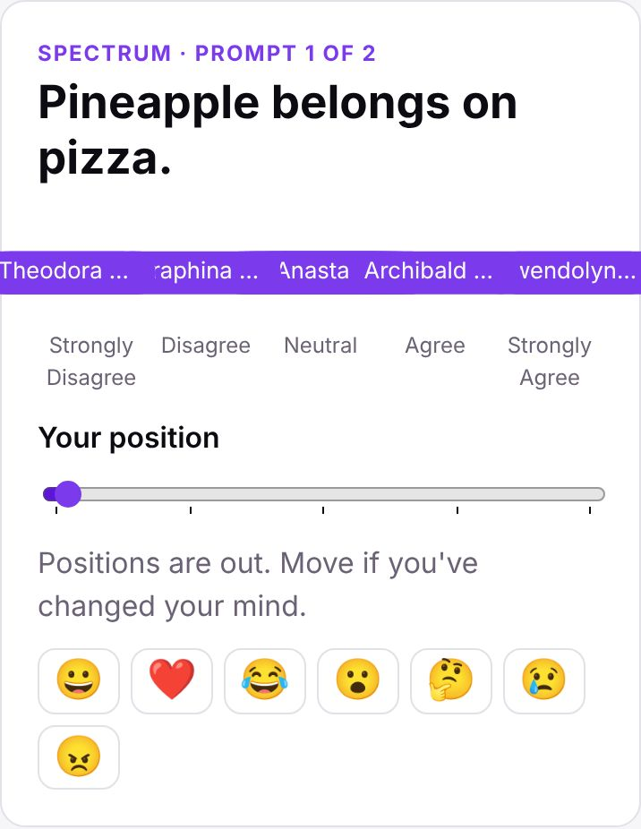       | 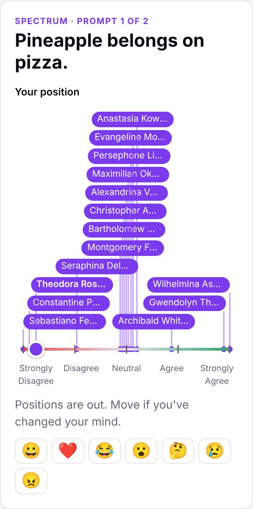       |
| Revealed, laptop (1280×800)            | 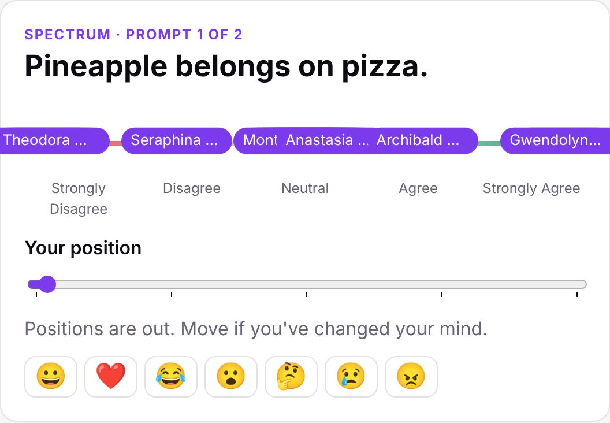      | 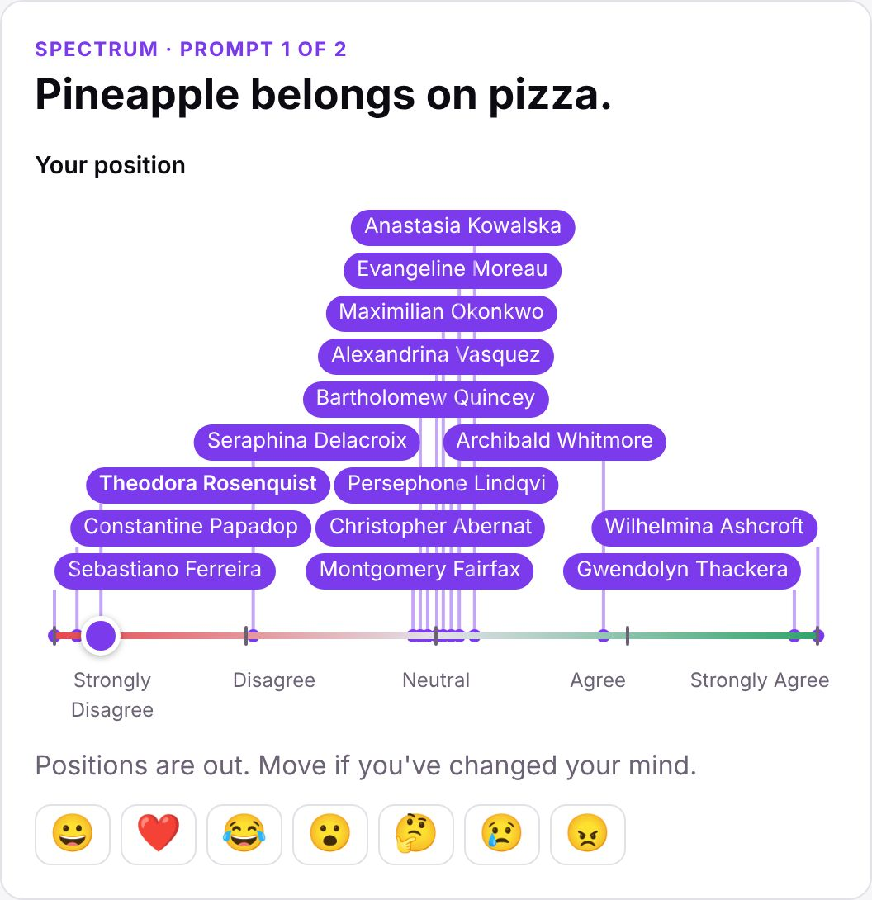      |
| Host, people hovering, laptop          | 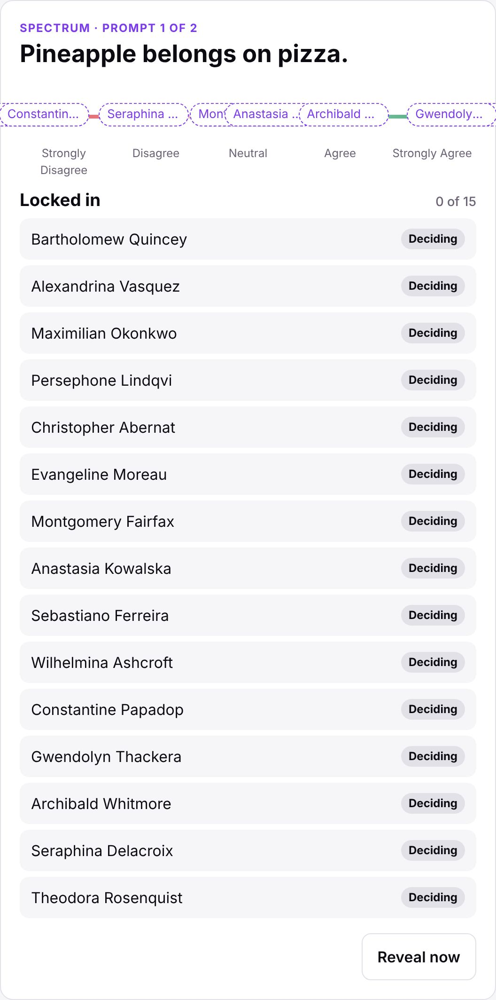 | 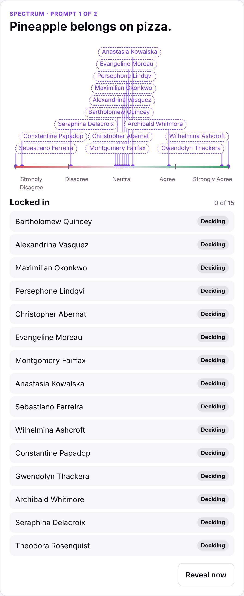 |
| Host, revealed, laptop                 | 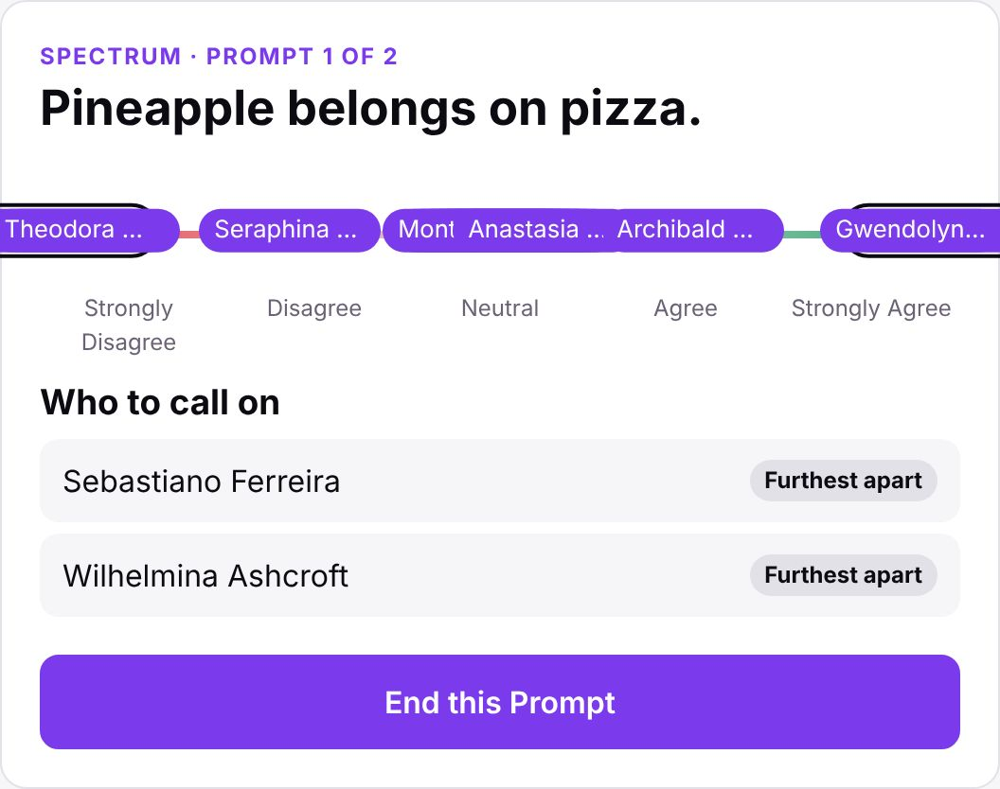 | 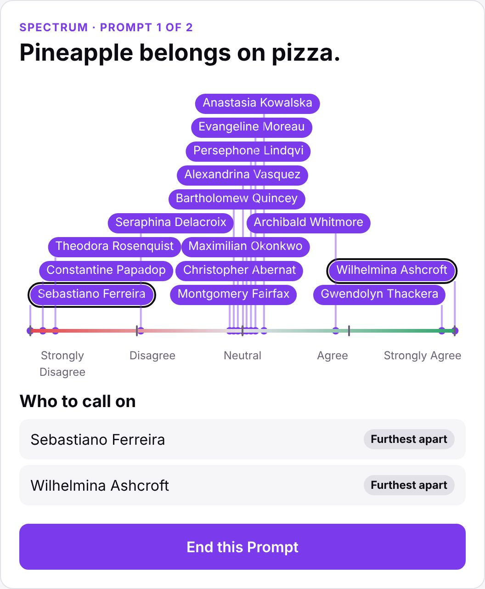 |
| Positioning, phone                     | 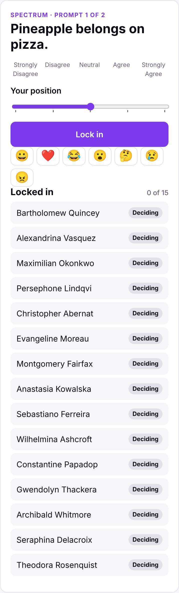    | 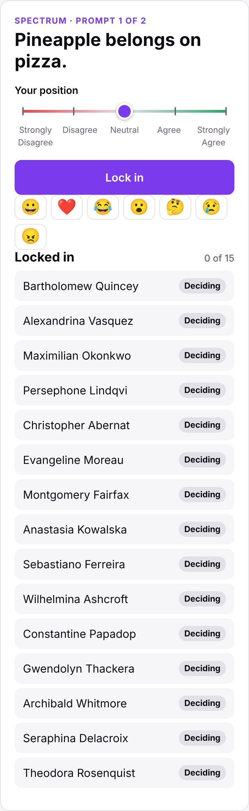    |
| Locked in, phone                       | 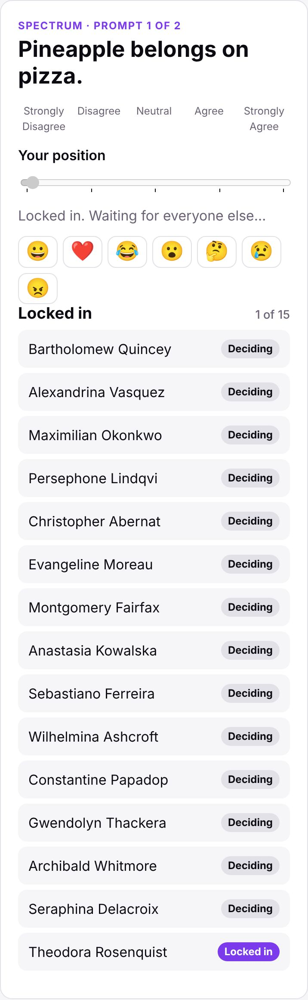         | 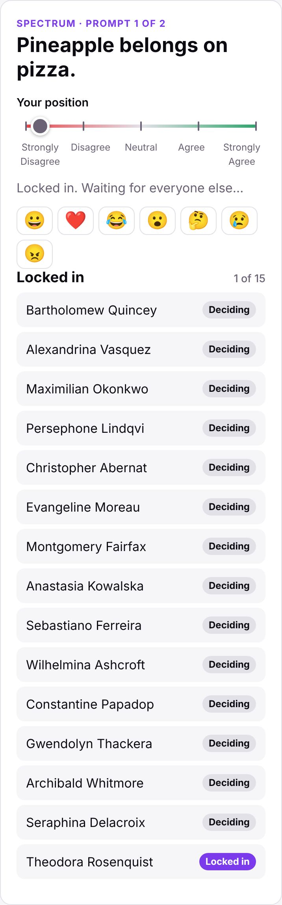         |
| Someone crosses a notch (pulse), phone | 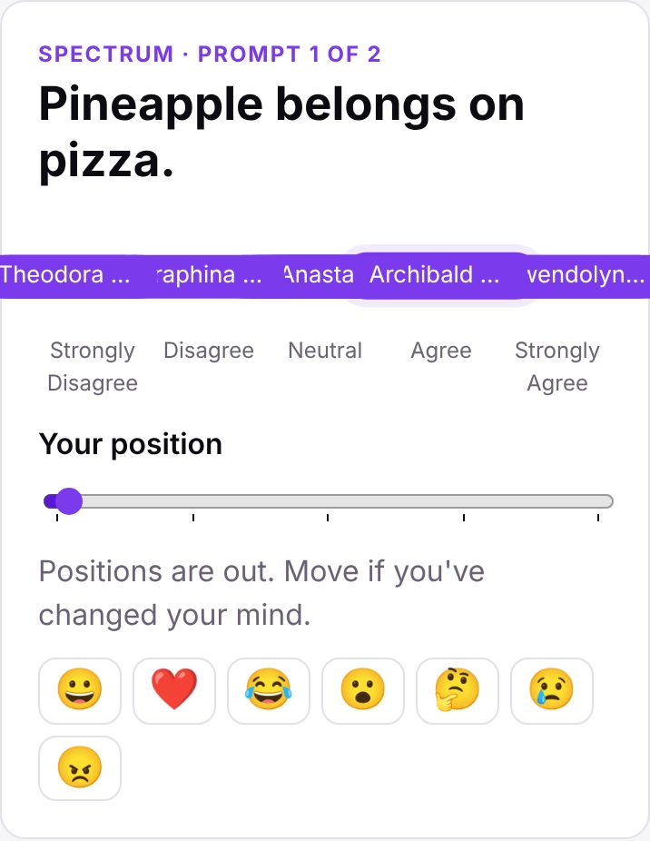          | 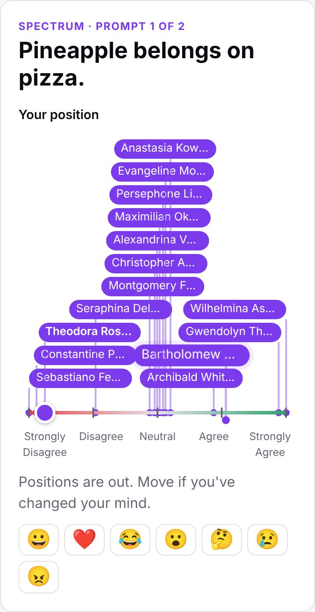          |

Dark mode, after (keyboard focus on the thumb): 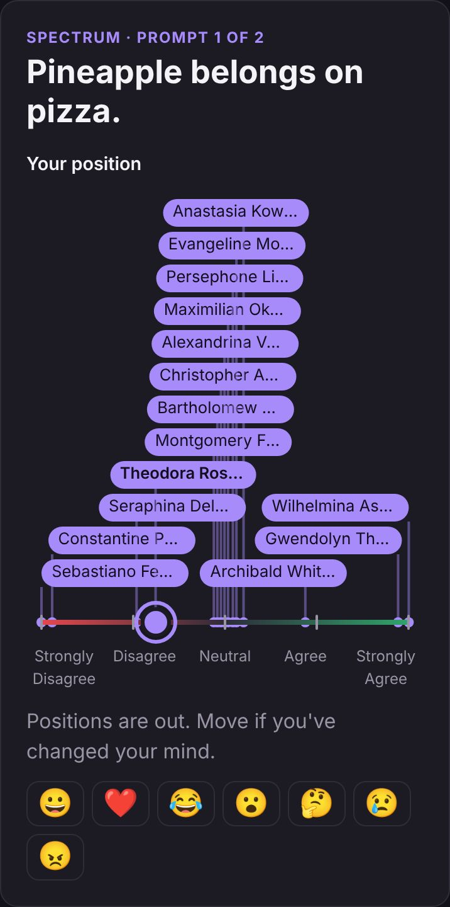

At 390 px, the before layout had **53 overlapping label pairs** and 5 labels hanging off the card. After: **0 overlaps and 0 off the card**, with no horizontal scroll. The cost is height: with 15 people bunched at one spot, the names take up to 15 rows (26 px each).

## Numbers

### Bundle (`vp run build`, client assets, against `main` with the UI SDK setup)

| Asset                | Before (`main`)           | After                     | Delta                                |
| -------------------- | ------------------------- | ------------------------- | ------------------------------------ |
| Main JS              | 186.72 kB (63.65 kB gzip) | 250.79 kB (87.71 kB gzip) | **+64.07 kB (+24.06 kB gzip, +38%)** |
| `announce` JS (lazy) | none                      | 0.72 kB (0.45 kB gzip)    | Pulled in by `Field`                 |
| CSS                  | 97.15 kB (13.60 kB gzip)  | 98.61 kB (13.92 kB gzip)  | +1.46 kB (+0.32 kB gzip)             |

Built once without `Field` (the thumb named by our own label), the main JS was 236.95 kB (83.18 kB gzip). So the `Slider` with its share of the runtime costs about **+19.5 kB gzip**, and `Field` about **+4.5 kB gzip**. This is the first UI SDK component on `main`, so it pays for the shared runtime. The Select spike measured +50 kB gzip for Select. Later components will share some of this.

### Lines of code

| File                              | Before | After |
| --------------------------------- | ------ | ----- |
| `SpectrumStage.vue`               | 296    | 392   |
| Spectrum section of `style.css`   | 106    | 216   |
| `lib/spectrumTrack.ts` (new)      | none   | 49    |
| `lib/spectrumTrack.test.ts` (new) | none   | 83    |

Most of the growth is the new label layout (measuring widths, stacking rows, stems and dots), not UI SDK. The slider itself is about the same size as the native `<input>` + `<datalist>` it replaces: around 25 lines of template. Its CSS is about 45 lines, because UI SDK parts come unstyled, or with web.css styles we override.

### Intents sent

WebSocket frames sent by the browser, counted in Playwright.

| Gesture                                    | Before                                                    | After                                           |
| ------------------------------------------ | --------------------------------------------------------- | ----------------------------------------------- |
| Mouse drag, 60 pointer moves               | 15 moves + 1 settled in 1.73 s (8.7/s)                    | 17 moves + 1 settled in 2.0 s (8.5/s)           |
| Touch drag (iPhone 13 emulation), 30 moves | 9 moves + 1 settled                                       | 9 moves + 1 settled                             |
| Touch tap on the track                     | move + settled                                            | move + settled                                  |
| One arrow / Page Up / Home / End press     | a settled move (plus a plain move if the throttle allows) | the same                                        |
| Holding an arrow (11 key repeats)          | a settled move per repeat (11)                            | throttled moves, then **one** settled on key-up |

The move rate is set by our own 120 ms throttle, which is unchanged, so drags send the same intents at the same rate. The one difference is holding an arrow key. UI SDK commits once, when the key comes up, so the Room records one settled position after the reveal instead of one per key repeat. That's arguably what "settled" means, but it changes what the Recap shows for keyboard users.

## Accessibility and keyboard

Checked in Chromium with the scripted Playwright run (not committed: the repo has no browser test setup).

- The thumb is a native `<input type="range" role="slider">` inside UI SDK's thumb, named "Your position" through `FieldLabel` (`aria-labelledby`).
- **Screen readers now hear the notch**: `aria-valuetext` is "Neutral", "Agree", or "62, between Neutral and Agree". Before, they heard a bare number.
- Arrow keys move 1. Home and End go to Strongly Disagree and Strongly Agree. **Page Up, Page Down and Shift with an arrow jump to the next notch.** Before, Page Up and Page Down moved by 10 (the browser's default), so they never landed on a notch.
- When locked in, the slider is disabled and can't be focused, as before. It's enabled again after the reveal.
- A touch drag on the track doesn't scroll the page (UI SDK sets `touch-action: none` on the control). Pressing anywhere on the track moves the thumb there and starts a drag.
- The focus ring is drawn on the thumb with `:has(:focus-visible)` in the accent color, and it's visible in dark mode.
- The notch pulse still fires when someone else crosses a notch, and on the notch label when you cross one yourself. With `prefers-reduced-motion: reduce`, the animation is replaced by a static ring, as before, and labels no longer slide.
- The other people's markers are plain text, read in Waiting Room order, as before. Their positions aren't announced. That's unchanged, and out of scope here.

## Rough edges

- **No custom key steps.** `largeStep` is a fixed distance. Notch jumps need the controlled-value swap described above. It works because a controlled slider ignores its own proposal, but it relies on reading `details.event.key` and `shiftKey`.
- **Commit on key-up**, not per key repeat (see [Intents](#intents-sent)). There's no option to commit per step.
- **web.css fights custom layout**: `[data-slot="field"]` adds a flex gap and `[data-slot="slider"]` a `min-width: 12rem`. The thumb's disabled style uses `opacity: 0.5`. All three needed overriding. The Field gap was the subtle one: it shifted the slider by 6 px, so the markers' stems missed the line.
- **The Slider root is an unnamed `role="group"`.** It's harmless for one thumb, but it shows up in the accessibility tree as an empty group.
- **The thumb is centered on its value** with `inset-inline` and auto margins, so at 0 and 100 it overhangs the track by half its width. The control needs side margins to match.
- **Dev reload**: the first visit under `vp dev` optimises `@ui-sdk/vue/field` and `@ui-sdk/vue/slider` and reloads the page, the same as in the Select spike. `optimizeDeps.include` would fix it.
- **Docs**: `slider.md` answered everything. `core.md` (400 KB) wasn't needed, since the stock Slider fit.

## Open questions for the redesign

- Should 15 names bunched at one spot take 15 rows, or should a crowded spot collapse into a count ("+6") that expands on tap? The stacking keeps every name legible, but it can make the card tall on a phone.
- Is one `settled` move per held arrow key the behaviour we want in the Recap? (It looks right, but it's a change.)
- Keep `Field` (+4.5 kB gzip, the documented way to label a control), or name the thumb with our own label? Other forms will probably bring `Field` in anyway.
