# Spike: building components on UI SDK

Issue #41. A time-boxed try at building Debate Room's UI components on [UI SDK](https://ui-sdk.dev/docs) (`@ui-sdk/core` + `@ui-sdk/vue`, `0.1.0-beta.17`). It covers two components: the Floor panel's **Speaking timer** and the Prompt picker's **Pack chooser**, along with its Intensity filter.

> **Decision:** the spike recommended UI SDK only for controls with no good native version. We chose to adopt it for every interactive control instead, for consistency; see [ADR 0003](../../adr/0003-ui-sdk-for-interactive-components.md). The spike's code (PR #42) was not merged; this write-up is kept as the evidence.

## Recommendation

**Adopt for some components, but not for Select.** UI SDK works with our stack, and its Select matches the native control for keyboard and screen-reader use. But here it replaces a control the browser already gets right, and it adds about 50 kB gzip to every page load, a 79% increase in the app's JavaScript. The clipped timer turned out to be a layout bug: the same CSS fix works on the native `<select>` (see below).

Use UI SDK where the platform has no good native control: Dialog/Alert Dialog, Popover, Menu, Toast, Tabs and Combobox. Measure each entry's bundle cost when we first need it. Since this is a two-way door, the cheapest next step is to close this PR and land only the CSS wrap fix (`.inline-form.wrap` and `.field.timer` in `src/style.css`) on the native select.

## What was built

- `src/components/SelectField.vue` (new): a labelled UI SDK `Select` that always holds one of its items. Both components use it.
- `FloorPanel.vue`: the Speaking timer is a `SelectField`. Its choices and value conversion moved to `src/lib/speakingTimer.ts` (tested), because a list item's value can't be `null` (Off).
- `PromptPicker.vue`: the Pack chooser and the Intensity filter are `SelectField`s. The grouped choices come from `packChoices()` in `src/content/packs.ts` (tested): Packs grouped by Topic, each named with its Intensity, then "Write your own".
- `src/style.css`: `@layer ui-sdk;` at the top, Select styles that use the existing tokens (trigger, list, items, group labels, separator), and the wrap fix for the timer row.
- The intents sent, the filter's "move off a hidden Pack" rule and clearing picked Prompts all work as before. All 541 tests pass (6 of them new).

## Screenshots

390×844 (phone) and 1280×800 (laptop), device scale 2.

|                        | Before (native `<select>`)            | After (UI SDK)                       |
| ---------------------- | ------------------------------------- | ------------------------------------ |
| Speaking timer, phone  | 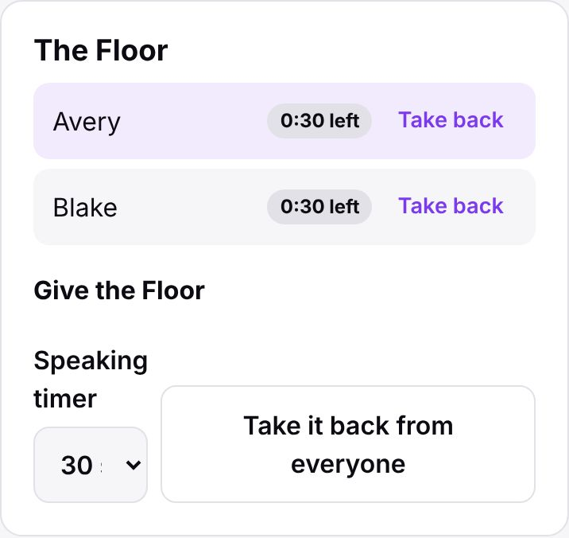  | 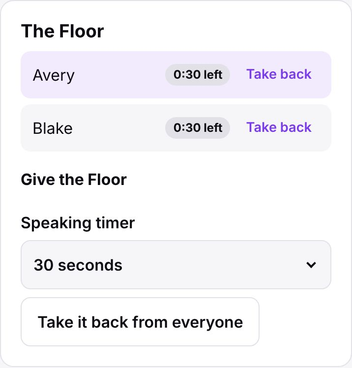  |
| Speaking timer, laptop | 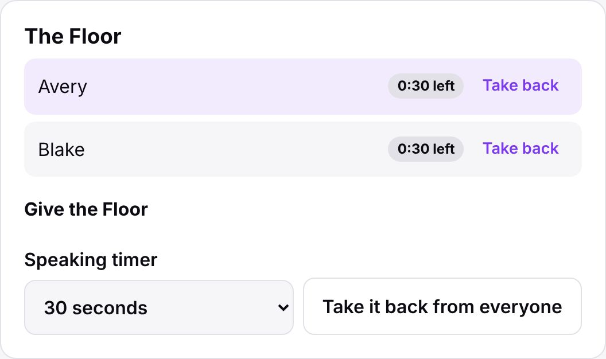 | 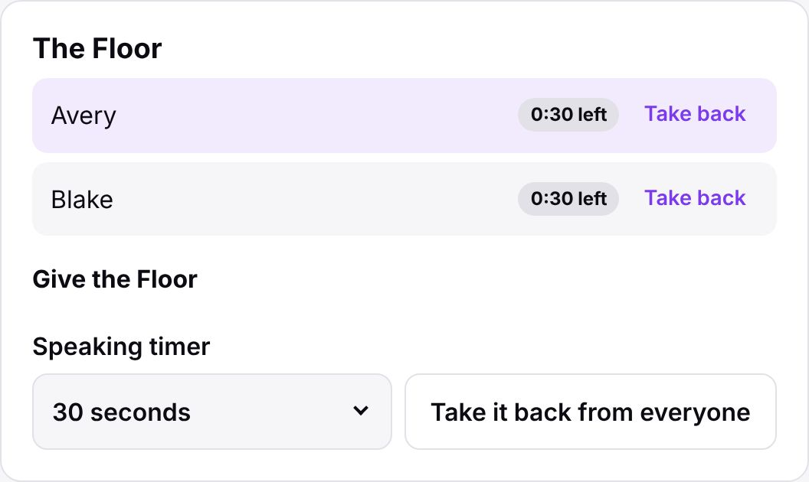 |
| Pack chooser, phone    | 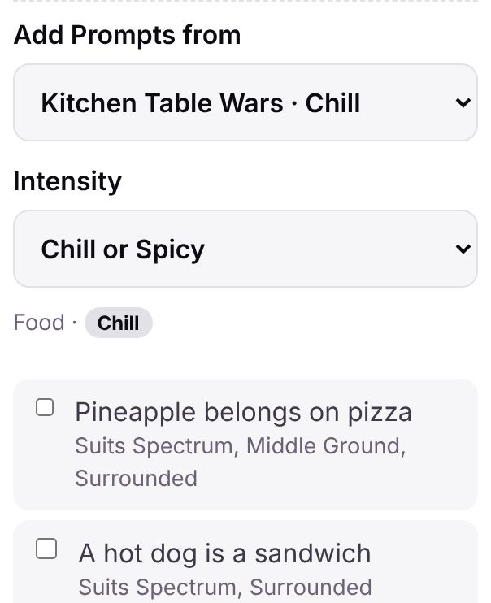    | 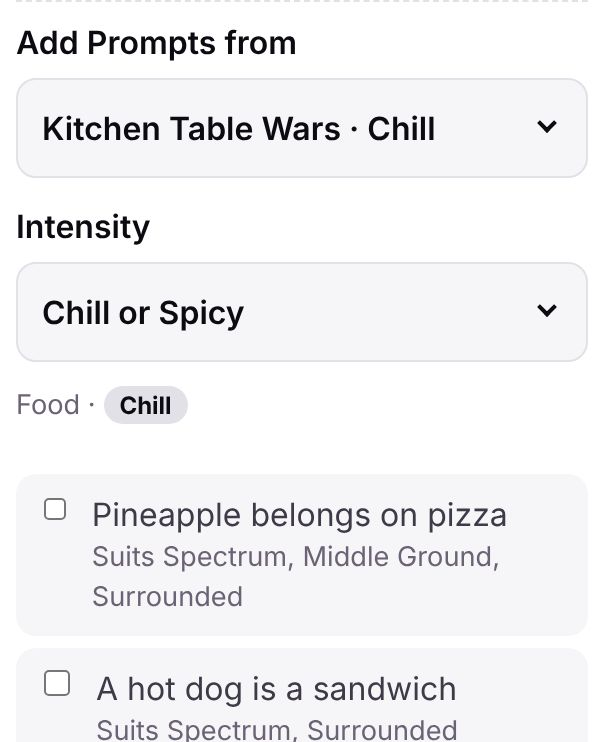    |
| Pack chooser, laptop   | 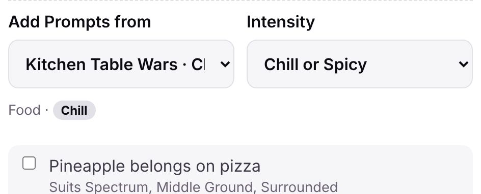   | 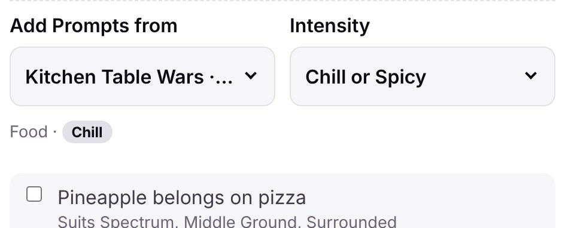   |

The lists open, at phone width: 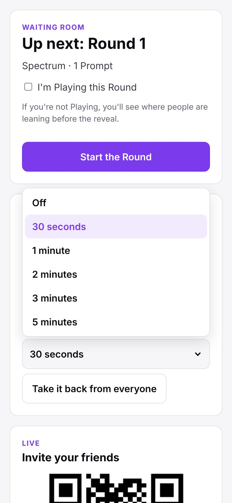 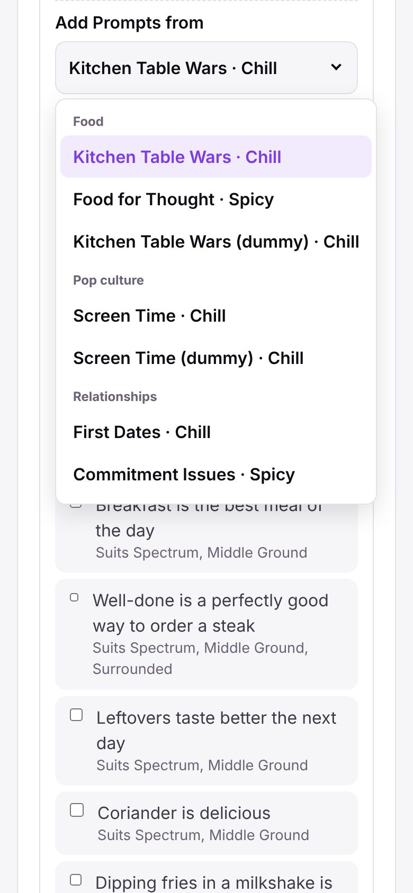

The same CSS wrap fix, on the native select: 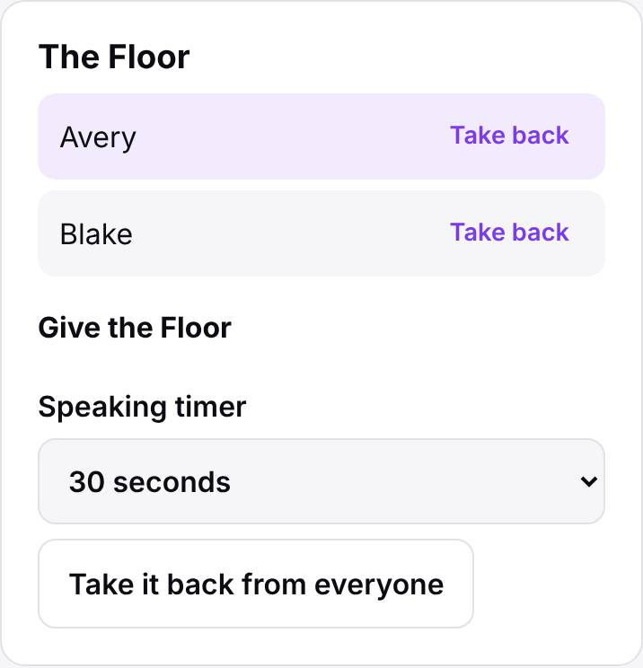

The timer clips to "30 :" only when two or more people have the Floor, because that's when the "Take it back from everyone" button squeezes the field. The before and after timer shots use that state.

## Numbers

### Bundle (`vp run build`, client assets)

| Asset                          | Before                    | After                      | Delta                                                               |
| ------------------------------ | ------------------------- | -------------------------- | ------------------------------------------------------------------- |
| Main JS                        | 186.72 kB (63.65 kB gzip) | 326.19 kB (113.76 kB gzip) | **+139.47 kB (+50.11 kB gzip, +79%)**                               |
| `sheet-presentation` JS (lazy) | none                      | 38.61 kB (13.89 kB gzip)   | Loaded only for `presentation="sheet"`/`"auto"`, which we don't use |
| CSS                            | 9.61 kB (2.74 kB gzip)    | 10.89 kB (3.03 kB gzip)    | +1.28 kB (+0.29 kB gzip): our Select styles                         |

Tree-shaking works (`@ui-sdk/vue` declares `sideEffects: false`, and nothing from the agent/WebMCP code ends up in the bundle). The Select entry is simply heavy: positioning, typeahead, list navigation, virtualisation hooks, async options and form integration all come with it, whether or not we use them.

### Lines of code

| File                                  | Before | After |
| ------------------------------------- | ------ | ----- |
| `FloorPanel.vue`                      | 144    | 130   |
| `PromptPicker.vue`                    | 141    | 158   |
| `SelectField.vue` (new, shared)       | none   | 29    |
| `lib/speakingTimer.ts` (new)          | none   | 24    |
| `packChoices()` in `content/packs.ts` | none   | 18    |
| Select styles in `style.css`          | none   | 88    |

Overall, about 160 more lines of app code and CSS for two selects. Without the shared `SelectField`, each use needed about 10 lines of parts plus a null guard.

## Accessibility and keyboard

These were checked in Chromium under `vp dev` with a scripted Playwright run (it's not committed: the repo has no browser test setup):

- Each trigger is a `combobox` named by its label, and the list is a `listbox`. In the Pack chooser, every Topic is a `group` named after it.
- Enter, Space and ArrowDown open the list. The open list focuses the chosen item, Home and End jump to the ends, Enter chooses, Escape closes without choosing, and focus goes back to the trigger.
- Typing on the closed trigger selects the matching item, as on a native select.
- Clicking the label focuses the trigger.
- Choosing the same Pack again doesn't clear the picked Prompts, as before.
- The timer shows the Room's value after a reload, because it is controlled by the server's state.
- Dark mode works with the existing tokens. The keyboard-focused item had the browser's white focus ring, so it now uses the accent outline that `button:focus-visible` uses.

There is one difference from native. On phones, a native `<select>` opens the OS picker, while this opens a popover. UI SDK's `presentation="auto"` gives a bottom sheet on small touch screens, but it pulls in the 13.9 kB gzip lazy chunk. It isn't enabled here.

## Compatibility

- **Vue 3.5.44**: fine (needs ≥ 3.5). The optional Nuxt peers cause no warnings under pnpm.
- **Vite+ / Rolldown build and Cloudflare Vite plugin**: `vp run build` and `vp dev` (Workers + Vite) both work. In dev, the first page that uses a Select makes Vite optimise `@ui-sdk/vue/select` and reload the page (`optimized dependencies changed. reloading`). Adding the entries to `optimizeDeps.include` would stop that.
- **vue-tsc**: generic components work. `ListData<Intensity | "any">` flows through `<script setup generic="T extends string">`, so the Intensity handler is typed with no casts.
- **Beta**: `latest` is `0.1.0-beta.17` and `beta` is `0.1.0-beta.18`. Both packages are pinned exactly.

## API rough edges

- **`null` means "nothing chosen"**: `value` and `@value-change` are typed `T | null` even when a choice is always made, so every handler needs a null guard (`SelectField` holds it). For the same reason a list value can't be `null`, so "Off" had to become `"off"`.
- **The label is a `
`**: `SelectLabel` names the trigger with `aria-labelledby`, so our `<label class="field">…<select>` pattern doesn't carry over. The fields became `
`.
- **Styling is global**: items rendered from `items` are bare parts. Vue's scoped styles don't reach them, so the styles go in `style.css` and target `[data-slot=…]`. Our global `button { … }` rule also applies to the trigger (it's a `<button>`) and has to be overridden.
- **List borders and padding are on us**: the `ui-sdk` layer strips the popover defaults for some components but not for Select content, so the docs ask for your own border, padding and background (`web.css` would provide them).
- **Docs are good but large**: `select.md` is 80 KB. The installed copy matches the version, which helps.

## The agent skill

- `npx skills@latest add vercel-labs/ui --skill ui-sdk` **fails in this repo**: npm refuses to run because `package.json`'s `devEngines` requires pnpm (`EBADDEVENGINES`). `pnpm dlx skills@latest add vercel-labs/ui --skill ui-sdk --agent claude-code -y` works, and it copied the skill into `.claude/skills/ui-sdk` and added an entry to `skills-lock.json`. Both are in this PR.
- **It helped**: it pointed straight at the version-matched docs in `node_modules/@ui-sdk/vue/docs` (index first, then only `components/select.md`). It gave the component-picking table, the `@layer ui-sdk;` rule and "style from `data-slot`", and its color-check rule caught the white focus ring in dark mode.
- **Where it doesn't fit**: it asks every task to end with an "agent-ready" pass (`createAgent`, WebMCP) and jsdom component tests. Neither is set up here, and both are out of scope for this spike. Its "no JSDoc on app code" rule conflicts with this repo's habit of short doc comments; this PR follows the repo. Its Quick Start also suggests adding a note to `AGENTS.md`, which this repo doesn't have (it uses `CLAUDE.md`), so I left that out.

## If we adopt it later

- Convert the other native Pack select (the "plan a whole night" shortcut in `LineupEditor.vue`) through `SelectField`, so the Pack label format lives in one place (`packChoices`).
- Decide whether phones should get `presentation="auto"`.
- Add `@ui-sdk/vue/*` entries to `optimizeDeps.include`.
- Decide whether to add a jsdom + Vue Test Utils setup for component tests, as the skill expects.
